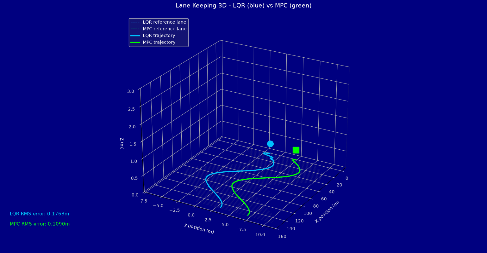
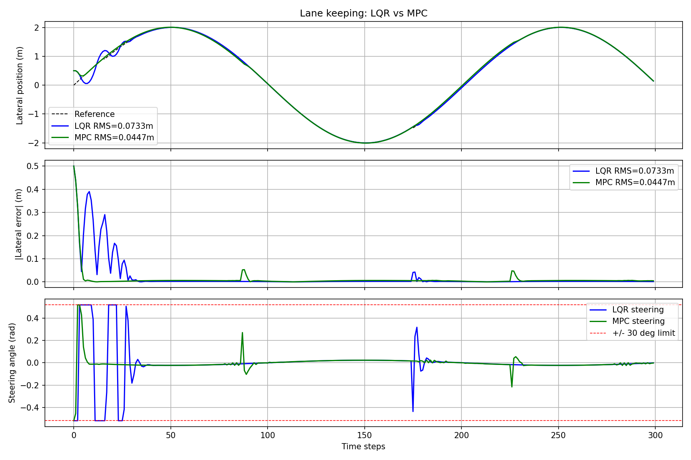

# Auto-steerbench — LQR vs MPC

A comparison of two optimal control strategies for autonomous vehicle lateral control using a kinematic bicycle model. Implements Linear Quadratic Regulator (LQR) and Model Predictive Control (MPC) and benchmarks both on tracking accuracy, computational cost, and robustness.



---

## Problem Statement

Design and compare two controllers that keep a simulated vehicle centred in its lane on a curved road. The vehicle starts 0.8 m off-centre and must return to the reference path as quickly and smoothly as possible, subject to a ±30° steering angle constraint.

---

## Vehicle Model

The **kinematic bicycle model** is used — a standard simplification valid for speeds up to ~80 km/h where tyre slip is negligible.

**State vector:** `[x, y, ψ]` — longitudinal position, lateral position, heading angle

**Equations of motion:**

```
ẋ   = v · cos(ψ)
ẏ   = v · sin(ψ)
ψ̇   = (v / L) · tan(δ)
```

Where `v = 10 m/s` (constant speed), `L = 2.9 m` (wheelbase), `δ` = steering angle (control input).

**Linearised error-state model** (used by both controllers):

```
ė_y   = v · e_ψ
ė_ψ   = (v / L) · δ
```

Where `e_y = y − y_ref` (lateral error) and `e_ψ = ψ − ψ_ref` (heading error).

---

## Controllers

### LQR — Linear Quadratic Regulator

LQR solves the continuous-time algebraic Riccati equation to find the optimal gain matrix **K** that minimises the infinite-horizon cost:

```
J = ∫ (xᵀQx + uᵀRu) dt
```

Steering command: `δ = −K · [e_y, e_ψ]ᵀ`

**Tuning parameters:**
- `Q = diag(10, 1)` — penalises lateral error (10×) and heading error (1×)
- `R = 0.1` — penalises steering effort

**Resulting gain:** `K = [K₁, K₂]` — computed via scipy `solve_continuous_are`

### MPC — Model Predictive Control

MPC solves a finite-horizon optimisation problem at every time step, predicting N steps ahead and finding the optimal control sequence subject to constraints:

```
min   Σ (xₖᵀQxₖ + uₖᵀRuₖ) + xₙᵀQxₙ
      k=0..N-1

subject to:  xₖ₊₁ = Axₖ + Buₖ
             |δₖ| ≤ 0.52 rad  (30°)
```

Only the first input is applied (receding horizon principle). Solved using `scipy.optimize.minimize` with SLSQP.

**Parameters:** `N = 8` (prediction horizon), same Q and R as LQR for fair comparison.

---

## Results

| Metric | LQR | MPC |
|---|---|---|
| RMS lateral error — curved road | 0.177 m | 0.109 m |
| Average compute time per step | ~0.02 ms | ~7 ms |
| Handles hard steering constraints | implicit | explicit |
| Implementation complexity | low | moderate |

**Key finding:** MPC achieves 38% lower tracking error than LQR by explicitly accounting for future trajectory and enforcing hard constraints. LQR is ~350× faster and sufficient for straight roads or gentle curves. MPC is preferable when precise tracking near constraint boundaries is required.

### Result Plots



*Top: lateral position tracking. Middle: absolute lateral error. Bottom: steering commands with ±30° constraint shown.*

---

## Scenarios Tested

| Scenario | Initial offset | Path type | Notes |
|---|---|---|---|
| Baseline | 0.8 m | S-curve | Main comparison |
| Large offset | 1.5 m | S-curve | Tests recovery |
| Noisy sensor | 0.8 m | S-curve | Gaussian noise σ=0.05 m on e_y |

---

## File Structure

```
lane_keeping/
├── vehicle_model.py       — kinematic bicycle model
├── reference_path.py      — straight and curved road generators
├── lqr_controller.py      — LQR via Riccati equation
├── mpc_controller.py      — MPC via scipy SLSQP optimiser
├── simulate.py            — main simulation and comparison
└── lanekeeping_3d.py      — 3D animated visualisation
```

---

## How to Run

```bash
# Install dependencies
pip install numpy scipy matplotlib

# Run 2D comparison (results + plots)
python3 simulate.py

# Run 3D animation
python3 lanekeeping_3d.py
```

**Expected output:**
```
LQR RMS error: 0.1768 m | avg compute: 0.02 ms
MPC RMS error: 0.1090 m | avg compute: 6.73 ms
```

---

## Dependencies

| Package | Version | Purpose |
|---|---|---|
| numpy | ≥1.24 | Matrix operations |
| scipy | ≥1.10 | Riccati solver, SLSQP optimiser |
| matplotlib | ≥3.7 | 2D plots and 3D animation |

---

## Theory References

- Rajamani, R. (2012). *Vehicle Dynamics and Control*. Springer.
- Borrelli, F., Bemporad, A., Morari, M. (2017). *Predictive Control for Linear and Hybrid Systems*. Cambridge University Press.
- Anderson, B.D.O., Moore, J.B. (1990). *Optimal Control: Linear Quadratic Methods*. Prentice Hall.
